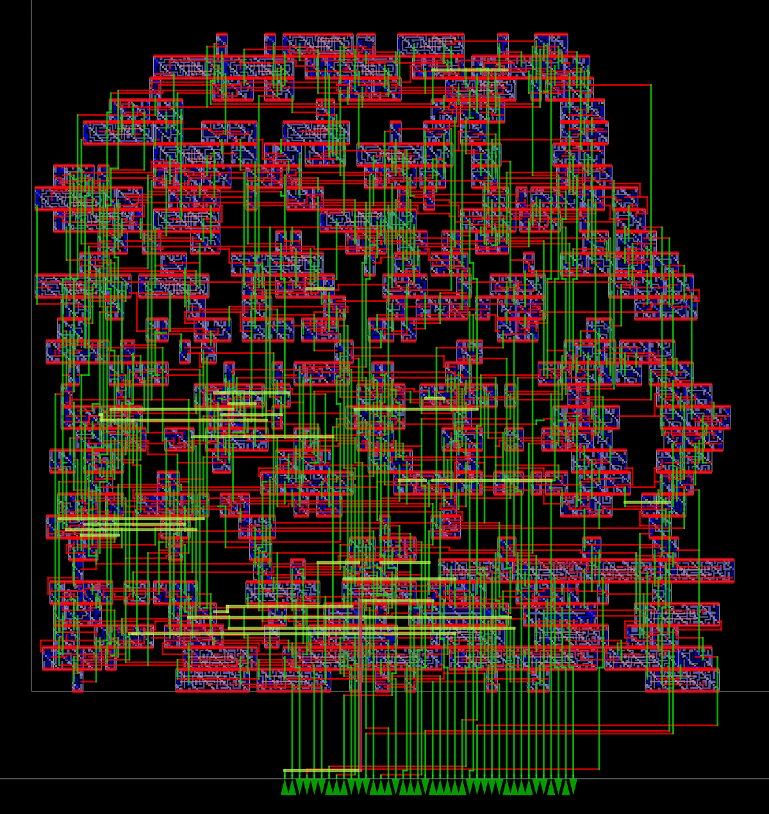

# 8-Bit Arithmetic & Logic Calculator ASIC (SkyWater 130nm)

An end-to-end open-source silicon physical implementation of a synchronous 8-bit Arithmetic & Logic Calculator core targeting the **SkyWater 130nm CMOS (`sky130_fd_sc_hd`)** process node using **Yosys** and **OpenROAD**.



---

## 📌 Project Overview

This project implements an 8-bit synchronous Arithmetic & Logic Unit (ALU / Calculator) capable of performing 8 mathematical and logical operations with zero and overflow flag detection. The entire digital flow—from Verilog RTL to functional verification, logic synthesis, and complete place-and-route (RTL-to-GDS)—was executed using a 100% open-source EDA toolchain.

### Key Architecture Features
- **Data Width:** 8-bit operands (`A`, `B`), 16-bit registered output (`result`)
- **Clocked Pipeline:** Synchronous clock (`clk`), active-low asynchronous reset (`rst_n`), and module enable (`enable`)
- **Flags:** `zero` flag and `overflow` / carry-out detection

---

## ⚙️ Instruction Set & Operations

| Opcode (`[2:0]`) | Operation | Description | Flag Handling |
|:---:|:---:|:---|:---|
| `3'b000` | **ADD** | $A + B$ | Sets `overflow` on 8-bit carry-out |
| `3'b001` | **SUB** | $A - B$ | Sets `overflow` on borrow ($A < B$) |
| `3'b010` | **MULT** | $A \times B$ | 16-bit product stored in `result[15:0]` |
| `3'b011` | **AND** | $A \ \& \ B$ | Bitwise AND |
| `3'b100` | **OR** | $A \ \| \ B$ | Bitwise OR |
| `3'b101` | **XOR** | $A \oplus B$ | Bitwise XOR (checks `zero` flag) |
| `3'b110` | **SHL** | $A \ll 1$ | Shift left (bit 7 shifted into `overflow`) |
| `3'b111` | **SHR** | $A \gg 1$ | Shift right (bit 0 shifted into `overflow`) |

---

## 📊 Physical Design & Silicon Metrics

| Metric | Result |
|:---|:---|
| **Process Node** | SkyWater 130nm (`sky130_fd_sc_hd`) |
| **Die Area** | $120\,\mu\text{m} \times 120\,\mu\text{m}$ |
| **Core Area** | $100\,\mu\text{m} \times 100\,\mu\text{m}$ ($10,000\,\mu\text{m}^2$) |
| **Standard Cell Area** | $3,440\,\mu\text{m}^2$ (35% utilization) |
| **Total Standard Cells** | **437 gates** |
| **Sequential Elements** | 18 × D-Flip-Flops (`sky130_fd_sc_hd__dfrtp_1`) |
| **Combinational Elements** | 419 gates (NAND, NOR, XOR, MUX, Majority gates) |
| **Target Clock Frequency** | **100 MHz** (10.0 ns period) |
| **Worst Slack (Setup)** | **+4.180 ns (MET)** |
| **Routing Layers** | 5 metal layers (`li1`, `met1`, `met2`, `met3`, `met4`) |
| **Total Wirelength** | $9,907\,\mu\text{m}$ (~9.9 mm) |
| **Via Count** | 3,080 inter-metal vias |
| **DRC Violations** | **0 (Design Rule Clean)** |

---

## 📁 Repository Structure

```
├── calculator.v           # Synthesizable RTL description
├── calculator_tb.v        # Directed testbench
├── calculator_synth.v     # Gate-level netlist mapped to Sky130
├── constraint.sdc         # 100 MHz timing constraints
├── pnr_flow.tcl           # OpenROAD physical design automation script
├── calculator_final.def   # Final placed-and-routed physical layout (DEF)
├── calculator_final.odb   # OpenROAD physical database (ODB)
├── calculator_layout.png  # High-resolution rendered silicon layout
└── README.md              # Project documentation
```

---

## 🛠️ How to Reproduce

### 1. Functional Verification (Icarus Verilog)
```bash
iverilog -o sim calculator.v calculator_tb.v
vvp sim
```

### 2. Logic Synthesis (Yosys)
```bash
yosys -p "
  read_verilog calculator.v;
  hierarchy -top calculator;
  synth -top calculator;
  dfflibmap -liberty ~/.volare/sky130A/libs.ref/sky130_fd_sc_hd/lib/sky130_fd_sc_hd__tt_025C_1v80.lib;
  abc -liberty ~/.volare/sky130A/libs.ref/sky130_fd_sc_hd/lib/sky130_fd_sc_hd__tt_025C_1v80.lib;
  clean;
  write_verilog calculator_synth.v
"
```

### 3. Place & Route (OpenROAD)
```bash
openroad pnr_flow.tcl
```
To view the layout interactively:
```bash
openroad -gui
# In OpenROAD console:
read_db calculator_final.odb
```
